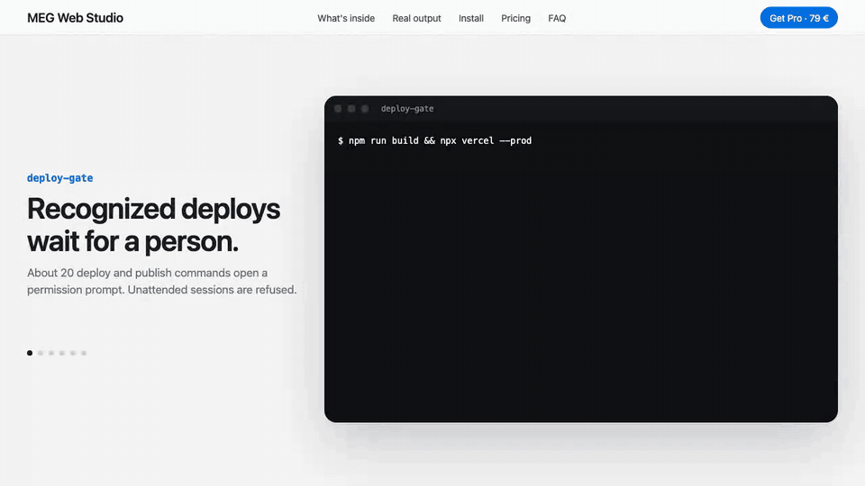

# Studio Kit for Claude Code

Guardrails and QA for building websites with Claude Code, from a working web studio.
Two hooks that stop the expensive mistakes, three skills that check the page before anyone says "done".



| | What it does |
|---|---|
| **deploy-gate** (hook) | Asks a person before about 20 deploy and publish commands it recognizes (Vercel, Netlify, Cloudflare, Firebase, Railway, Fly, npm, Docker, Shopify themes, Terraform and more) and before pushes to production branches. A tool it does not know passes through: open an issue and we add it. |
| **secret-guard** (hook) | Blocks key formats from common providers (Stripe, OpenAI, Anthropic, AWS, GitHub, Google and more) written into source code or given a browser-exposed name (`VITE_`, `NEXT_PUBLIC_`, `PUBLIC_`, `REACT_APP_` ...), and `git add` of a `.env` that is not ignored. |
| **launch-qa** (skill) | Renders the page at 390, 768 and 1440 px and fails on console errors, failed requests, sideways scroll, missing alt text, broken links, tiny text and tap targets. |
| **five-attacks** (skill) | A ten-minute pre-launch test of the five attacks that hit small sites: stolen key, AI endpoint called in a loop, bot-flooded form, impersonation, fake payment. |
| **concrete-copy** (skill) | Rules for the words on a page, plus a linter that fails AI-tell copy ("unlock", "seamless", "not just X, it's Y", em dashes, "Learn more"). |

The scripts run on your machine and the kit adds no telemetry or accounts; Claude Code itself sends your prompts and the context it reads to the model as usual. Standard-library Python.

## Install

Inside Claude Code:

```
/plugin marketplace add megwebstudio/studio-kit
/plugin install studio-kit@studio-kit
```

Restart the session and the hooks are active. Skills load on their own when the task matches,
or call them by name ("run launch-qa on dist/").

Requirements: Claude Code 2.1 or later, Python 3.9 or later (tested on 3.9 and 3.15). `launch-qa` also needs Playwright:
`python3 -m pip install playwright && python3 -m playwright install chromium`.

## Real output

Every block below is the unedited output of the code in this repository, produced by
[`tools/capture_examples.py`](tools/capture_examples.py) on demo inputs. Fake keys are generated at runtime and
only ever printed masked.

**deploy-gate**: Claude tries to deploy to production during a normal session. The hook answers `ask`, so
Claude Code shows you a permission prompt with this reason:

```
$ npm run build && npx vercel --prod
decision: ask
deploy-gate: this looks like a Vercel production deploy. A person should confirm production changes. Approve only if you asked for this deploy.
```

In `bypassPermissions` mode nobody can be asked, so the hook denies and tells Claude to stop:

```
$ git push origin main  (in bypassPermissions mode)
decision: deny
deploy-gate blocked a git push to production branch 'main'. Do not retry or work around this. Stop and ask the user to confirm the deploy; they can run the command themselves, or add a pattern to .claude/deploy-gate-allow for deploys that never need a prompt.
```

**secret-guard**: Claude is about to write an OpenAI key into a variable that Vite inlines into the browser bundle:

```
$ Write .env.local: VITE_OPENAI_API_KEY=sk-proj-...
decision: deny
secret-guard blocked this change in .env.local:
- VITE_OPENAI_API_KEY holds an OpenAI API key and is bundled into browser JavaScript: sk-pro... (56 chars)
Keep secrets server-side: put the value in a gitignored .env under a name WITHOUT a browser prefix (not VITE_/NEXT_PUBLIC_/PUBLIC_/REACT_APP_), read it only in server code (API route, edge function, backend), and reference it by name. For .env files: add them to .gitignore and commit a .env.example with empty values. Do not retry with the same value or split it to evade this check; tell the user.
```

**five-attacks** (attack 1, stolen key): scanning a build folder where a key leaked into a chunk:

```
$ python3 scan_bundle.py dist/
scanned 1 file(s) in dist
FAIL: 1 finding(s)
  assets/index-4f2a.js  OpenAI API key  sk-pro... (56 chars)
(exit 1)
```

**launch-qa** on a small restaurant page with four planted defects (wide banner, image without alt,
console error, dead link). All four are caught; the report and full-page screenshots are written to `qa-out/`:

```
$ python3 launch_qa.py site/
launch-qa FAIL  http://127.0.0.1:62369/
  PASS  page-load            HTTP 200, load 5 ms (desktop)
  FAIL  console-errors       1 distinct error(s)
  FAIL  failed-requests      1 failed request(s)
  FAIL  horizontal-overflow  page scrolls sideways (worst: mobile, +1210px)
  PASS  title                12 chars: Osteria Lume
  WARN  meta-description     26 chars (aim for 50-160)
  WARN  og-tags              missing og:title, og:image
  PASS  lang                 lang="en"
  PASS  h1                   1 <h1>: Fresh pasta every morning
  FAIL  img-alt              1 of 1  without alt attribute
  PASS  meta-viewport        width=device-width,initial-scale=1
  PASS  small-text-mobile    4 text elements, none under 12px
  WARN  tap-targets-mobile   1 of 2 targets under 40px
  FAIL  internal-links       1 of 2 same-origin links broken
report: qa-out/report.md
(exit 1)
```

**concrete-copy** on a hero written in the usual AI register:

```
$ python3 copy_lint.py index.html
== index.html  (5 text blocks)  FAIL 5  WARN 3
  FAIL AI-tell word 'elevate' in <title>: Elevate Your Dining Journey
  FAIL AI-tell word 'seamless' in <h1>: Unlock a seamless taste experience
  FAIL AI-tell word 'unlock' in <h1>: Unlock a seamless taste experience
  FAIL 'not just X, it's Y' shape in <p>: Not just a restaurant, it's a lifestyle — crafted with passion.
  FAIL em dash in <p>: Not just a restaurant, it's a lifestyle — crafted with passion.
  WARN soft word 'journey' (keep only if literal) in <title>: Elevate Your Dining Journey
  WARN soft word 'passion' (keep only if literal) in <p>: Not just a restaurant, it's a lifestyle — crafted with passion.
  WARN vague button/link text 'Learn more' (use verb + object)
RESULT: FAIL
(exit 1)
```

## Configuration

| Setting | Values | Default |
|---|---|---|
| `STUDIO_KIT_DEPLOY_GATE` | `ask`, `deny`, `off` | `ask` (`deny` when permissions are bypassed) |
| `STUDIO_KIT_PROD_BRANCHES` | comma list | `main,master,production,prod,release,live` |
| `STUDIO_KIT_SECRET_GUARD` | `on`, `ask`, `off` | `on` (deny high-confidence keys, ask otherwise) |
| `.claude/deploy-gate-allow` | one regex per line | commands that never need a prompt. The regex is searched in the whole command line, so anchor it: `^wrangler deploy --env staging$` |
| `.claude/secret-guard-allow` | one glob per line | paths to skip, e.g. `tests/fixtures/*` (`*` also matches subfolders) |

Real `.env` files with server-side names are allowed: that is where secrets belong. Findings are shown
masked (first 6 characters and length).

These hooks are guardrails against accidents, not a security boundary: a person with shell access can always
deploy. If Python is missing the hooks print a warning and let the command through rather than blocking your work.

### What the hooks do not catch (1.0.0)

They read the command line and the content being written. Known gaps, each one reproduced:

- A deploy started by a script: `npm run deploy`, `bash deploy.sh`. The gate does not read what the script runs.
- `git` with an option before `push`: `git -c user.name=x push origin main` and `git --no-pager push origin main`
  pass. `git push origin main` and `git -C <dir> push origin main` are asked.
- `surge` after a single `&`: `echo ok & surge ./dist` passes. The other tools are still asked there, and `&&`,
  `||`, `;` and `|` are split correctly.
- A `.env` in a subfolder when you add a folder or everything: `git add src/`, `git add .`, `git commit -am`.
  Only the project root is checked there. `git add src/.env` by name is blocked.
- An allowlist line without anchors: `wrangler deploy --env staging` also lets through
  `wrangler deploy --env staging && vercel --prod`.
- Changes to the two allowlist files. They are ordinary project files that Claude can edit: keep them in git and
  read the diff.
- Any file named `.env` or `.env.<something>` counts as a real `.env`: `.env.js`, `.env.production.ts` and
  `public/.env` are not scanned for keys, only for browser-exposed names.
- A key written under `test/`, `tests/`, `fixtures/` or `spec/` is asked, not blocked.

Found another one? Open an issue with the command.

## Tests

```
python3 -m unittest discover -s plugins/studio-kit/hooks/tests
python3 -m unittest discover -s plugins/studio-kit/skills/five-attacks/tests
python3 -m unittest discover -s plugins/studio-kit/skills/concrete-copy/tests
python3 -m unittest discover -s plugins/studio-kit/skills/launch-qa/tests
```

## Studio Kit Pro

The free core checks the work. **Pro** is the pipeline that produces it: twelve skills a studio runs from brief to
launch, with scripts, templates and tests.

`creative-director` · `web-art-director` · `web-designer` · `website-builder` · `conversion-copywriter` ·
`seo-specialist` · `cro-specialist` · `security-engineer` · `graphics-engineer` · `scroll-scrub-hero` ·
`site-archetypes` · `visual-qa`

79 € one-time, one seat, unlimited client projects: **[megwebstudio.com/kit](https://megwebstudio.com/kit/)**

## Works well with

Studio Kit pairs with community design skills you may already use, such as
[Impeccable](https://github.com/pbakaus/impeccable) and
[UI UX Pro Max](https://github.com/nextlevelbuilder/ui-ux-pro-max-skill). They are not part of this kit.

## License

MIT for this repository. Studio Kit Pro has its own license.

Studio Kit is an independent project by [MEG Web Studio](https://megwebstudio.com). Claude Code is a product of
Anthropic; this project is not affiliated with or endorsed by Anthropic.
