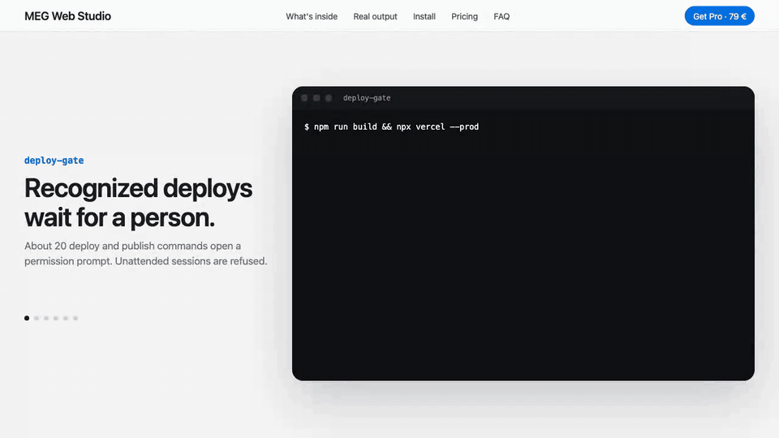

# Studio Kit for Claude Code

Guardrails and QA for building websites with Claude Code, from a working web studio.
Two hooks that stop the expensive mistakes, three skills that check the page before anyone says "done".



| | What it does |
|---|---|
| **deploy-gate** (hook) | Asks a person before about 20 deploy and publish commands it recognizes (Vercel, Netlify, Cloudflare, Firebase, Railway, Fly, npm, Docker, Shopify themes, Terraform and more) and before pushes to production branches. A tool it does not know passes through: open an issue and we add it. |
| **secret-guard** (hook) | Blocks key formats from common providers (Stripe, OpenAI, Anthropic, AWS, GitHub, Google and more) written into source code or given a browser-exposed name (`VITE_`, `NEXT_PUBLIC_`, `PUBLIC_`, `REACT_APP_` ...), and `git add` of a `.env` that is not ignored. |
| **launch-qa** (skill) | Renders the page at 390, 768 and 1440 px and fails on console errors, failed requests, sideways scroll, missing alt text, broken links, tiny text and tap targets. |
| **five-attacks** (skill) | A ten-minute pre-launch test of the five attacks that hit small sites: stolen key, AI endpoint called in a loop, bot-flooded form, impersonation, fake payment. |
| **concrete-copy** (skill) | Rules for the words on a page, plus a linter that fails AI-tell copy ("unlock", "seamless", "not just X, it's Y", em dashes, "Learn more"). |

The scripts run on your machine and the kit adds no telemetry or accounts; Claude Code itself sends your prompts and the context it reads to the model as usual. Standard-library Python.

## Data handling and network access

Studio Kit is a local developer tool for web developers and studios, not a hosted service or a product intended for children under 18. MEG Web Studio does not receive or retain Claude session data through this plugin. The plugin adds no telemetry, account system, or automatic upload of project files or QA reports. Claude Code's own model/context handling is separate.

- Local inputs and outputs: hooks inspect tool input (commands and proposed file content); scanners and the copy linter read the files or pages you select. launch-qa saves full-page screenshots and report.md/report.json locally in its output folder. Page text, URLs, console errors and screenshots may contain personal or confidential data. These files are not automatically deleted; you control their retention and sharing.
- Network destinations are the URLs you choose, not MCP connectors. copy_lint.py fetches the selected page. scan_bundle.py fetches the selected page and follows scripts/imports/source maps selected on the same host. HTTP redirects can lead to another host. launch-qa opens the chosen page in Chromium, runs its JavaScript, and checks same-origin links; the page itself may contact its own third-party services, and redirects are followed.
- probe_endpoint.py sends the JSON/form body and optional headers you supply to the selected endpoint (at most 100 requests). Use synthetic test data and only systems you own or are authorized to test; the script does not enforce synthetic-only payloads. A real endpoint may store the requests or trigger its normal downstream actions.
- Network traffic exposes ordinary request metadata (such as the requesting IP) to the destination. Destination-site and Claude-provider retention policies are outside this plugin; no 30-day deletion promise is made.

## Install

Inside Claude Code:

```
/plugin marketplace add megwebstudio/studio-kit
/plugin install studio-kit@studio-kit
```

Restart the session and the hooks are active. Skills load on their own when the task matches,
or call them by name ("run launch-qa on dist/").

Requirements: Claude Code 2.1 or later, Python 3.9 or later (tested on 3.9 and 3.15). `launch-qa` also needs Playwright:
`python3 -m pip install playwright && python3 -m playwright install chromium`.

## Real output

Every block below is the unedited output of the code in this repository, produced by
[`tools/capture_examples.py`](tools/capture_examples.py) on demo inputs. Fake keys are generated at runtime and
only ever printed masked.

**deploy-gate**: Claude tries to deploy to production during a normal session. The hook answers `ask`, so
Claude Code shows you a permission prompt with this reason:

```
{{deploy_gate}}
```

In `bypassPermissions` mode nobody can be asked, so the hook denies and tells Claude to stop:

```
{{deploy_gate_bypass}}
```

**secret-guard**: Claude is about to write an OpenAI key into a variable that Vite inlines into the browser bundle:

```
{{secret_guard}}
```

**five-attacks** (attack 1, stolen key): scanning a build folder where a key leaked into a chunk:

```
{{scan_bundle}}
```

**launch-qa** on a small restaurant page with four planted defects (wide banner, image without alt,
console error, dead link). All four are caught; the report and full-page screenshots are written to `qa-out/`:

```
{{launch_qa}}
```

**concrete-copy** on a hero written in the usual AI register:

```
{{copy_lint}}
```

## Configuration

| Setting | Values | Default |
|---|---|---|
| `STUDIO_KIT_DEPLOY_GATE` | `ask`, `deny`, `off` | `ask` (`deny` when permissions are bypassed) |
| `STUDIO_KIT_PROD_BRANCHES` | comma list | `main,master,production,prod,release,live` |
| `STUDIO_KIT_SECRET_GUARD` | `on`, `ask`, `off` | `on` (deny high-confidence keys, ask otherwise) |
| `.claude/deploy-gate-allow` | one regex per line | the entire command must match, e.g. `wrangler deploy --env staging`; added commands are not covered by that line |
| `.claude/secret-guard-allow` | one glob per line | paths to skip, e.g. `tests/fixtures/*` (`*` also matches subfolders) |

Real `.env` files with server-side names are allowed: that is where secrets belong. Findings are shown
masked (first 6 characters and length).

These hooks are guardrails against accidents, not a security boundary: a person with shell access can always
deploy. If Python is missing the hooks print a warning and let the command through rather than blocking your work.

### Changes in 1.0.3

- A substitution inside a Git option (`git -C $(pwd) push`, `git --git-dir=$(pwd)/.git push`) no longer cuts the
  Git command in two: the substitution counts as an unresolved value, so the push asks.
- A `git config` or `git remote` change in the same command is reported and the `.env` scan still runs, so a real
  env finding is still denied.
- Allowlist writes are also caught through `git diff/log --output` and through `.claude/` paths with wildcards or
  variables; plain reads (`cat`, `ls`, `grep`, `git diff`) stay quiet.
- A subshell glued to a word (`then(...)`, `do(...)`), a process substitution (`<(...)`, `>(...)`), a computed
  subcommand (`git $(...)`, `git "$VERB"`) and very deep or very long `sh -c` nesting ask instead of passing.
  A push to a computed destination (`git push origin $(git branch --show-current)`, `"$BRANCH"`) asks. Allowlist names split by quotes or backslashes, or written after
  `cd .claude`, are recognized.

### Changes in 1.0.2

- The 1.0.0 reading of each command now runs next to the new parser and the stricter answer wins, so no command
  that 1.0.0 stopped can pass.
- Git commands inside strings that another command runs (`eval`, `ssh host "..."`, `watch`, `bash <<<`,
  `echo ... | sh`), in subshells `( ... )`, in `$(...)` and in backticks are checked.
- More routing overrides ask: `GIT_CONFIG*`, `GIT_COMMON_DIR`, `GIT_OBJECT_DIRECTORY`, `GIT_NAMESPACE`, `--bare`,
  `--exec-path`, an exported `GIT_DIR`, and `git config` or `git remote set-url` in the same command as a push or
  a `git add`.
- Writing `.claude/deploy-gate-allow` or `.claude/secret-guard-allow` from the shell (`>`, `tee`, `sed -i`, `cp`...)
  asks for confirmation; reading them does not.

### Changes in 1.0.1

- Literal Git global options and quoted/repeated `-C` directories no longer hide recognized pushes or env staging.
  Repository/configuration overrides that the checks cannot safely reproduce require review; pending `-c` settings
  are never executed by the checks.
- A single `&` separates commands, while quoted/escaped separators in paths remain intact.
- Git supplies the candidate env paths recursively, including tracked files that are now ignored; literal directory
  pathspecs are respected. A staging exception must match the entire command, not just its first part.
- Direct Write/Edit/MultiEdit/NotebookEdit changes to either allowlist require confirmation. Relative paths are
  normalized before allowlist matching; direct policy edits through an existing symlink are also checked.
- `.env.js`, other recognized source extensions and env files under public/output directories are scanned for keys.
  Private server-side env files remain allowed. Fixture findings still ask interactively, but findings deny when
  the runtime reports `bypassPermissions` or `dontAsk` instead of relying on an unavailable prompt.
- Shell comments are skipped, so a quote inside `# ...` no longer hides the command after it. Command strings
  given to `sh -c`, `bash -c` or `zsh -c` are checked too. When the quoting cannot be followed, or a `-C`
  directory uses `~`, `$VAR`, a backtick or a missing path, a push or staging command asks instead of passing.

### Remaining limitations

They read command text and proposed file content; they are not a shell interpreter or a security sandbox.

- A deploy started inside a script, alias or function (`npm run deploy`, `bash deploy.sh`) can still be missed.
- Here-documents, variables, dynamic paths/options, environment changes and shell control structures are not
  comprehensively resolved; substitutions and subshells are only split, not evaluated. Git context overrides are
  handled conservatively, not fully emulated.
- Quoted multi-word strings are read as possible commands, so a commit message that mentions `git push origin main`
  can ask. The checks err on the side of asking.
- Shell commands that name an allowlist file ask, but a script, another path to the same file or an edit to the
  hook itself can still change the policy. Keep those files in Git and review changes; the checks do not make the
  policy immutable. Explicitly broad allowlist patterns remain broad.
- Secret matching covers known patterns, not every credential or encoded/generated value. The Git check focuses
  on env filenames; it is not a full staged-content secret scanner. An interactive fixture finding still asks.
  A forced `git add -f .` or `git add --force <dir>` can stage an ignored `.env` without a warning; a forced add
  of a named env file is blocked.
- When secret-guard asks about a file write (for example a key in a test fixture), Claude Code shows its normal
  file dialog. In the version tested (2.1.314) the hook's reason is not shown there: read the content preview
  before you approve. For Bash commands the reason is shown in the prompt.
- Internal errors, missing Python and unavailable Git checks can leave a command unexamined. The wrapper warns
  on hook failure; these controls are accident prevention, not a substitute for sandboxing or a release review.

Found another one? Open an issue with the command.

## Tests

```
python3 -m unittest discover -s plugins/studio-kit/hooks/tests
python3 -m unittest discover -s plugins/studio-kit/skills/five-attacks/tests
python3 -m unittest discover -s plugins/studio-kit/skills/concrete-copy/tests
python3 -m unittest discover -s plugins/studio-kit/skills/launch-qa/tests
```

## Studio Kit Pro

The free core checks the work. **Pro** is the pipeline that produces it: twelve skills a studio runs from brief to
launch, with scripts, templates and tests.

`creative-director` · `web-art-director` · `web-designer` · `website-builder` · `conversion-copywriter` ·
`seo-specialist` · `cro-specialist` · `security-engineer` · `graphics-engineer` · `scroll-scrub-hero` ·
`site-archetypes` · `visual-qa`

79 € one-time, one seat, unlimited client projects: **[megwebstudio.com/kit](https://megwebstudio.com/kit/)**

## Works well with

Studio Kit pairs with community design skills you may already use, such as
[Impeccable](https://github.com/pbakaus/impeccable) and
[UI UX Pro Max](https://github.com/nextlevelbuilder/ui-ux-pro-max-skill). They are not part of this kit.

## License

MIT for this repository. Studio Kit Pro has its own license.

Studio Kit is an independent project by [MEG Web Studio](https://megwebstudio.com). Claude Code is a product of
Anthropic; this project is not affiliated with or endorsed by Anthropic.
